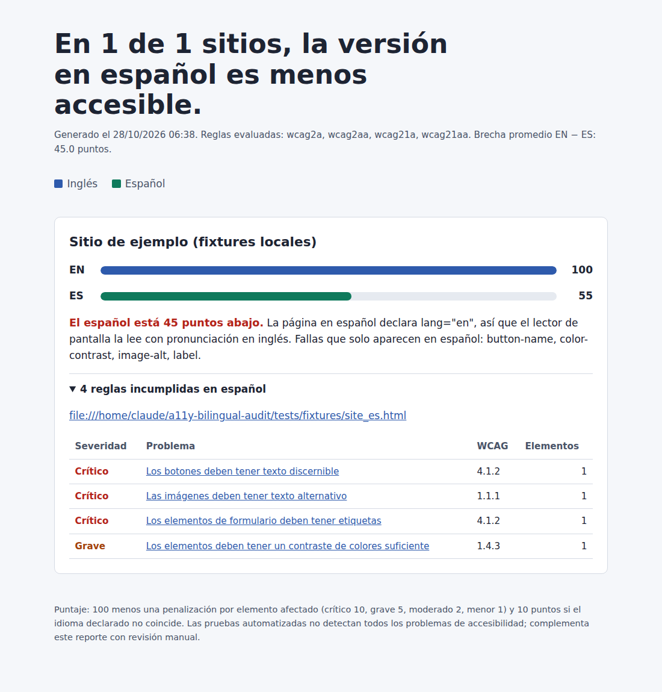

# a11y-bilingual-audit

Auditoría automatizada de accesibilidad **WCAG 2.1 AA** que compara la versión en **inglés** y en **español** de un mismo sitio y mide la brecha entre ambas.

> *Automated WCAG 2.1 AA accessibility audit that compares the English and Spanish versions of a website and measures the accessibility gap between them.*



## El problema

Muchos sitios públicos traducen su contenido al español, pero la versión traducida suele recibir menos cuidado: imágenes sin texto alternativo, formularios sin etiquetas o el atributo `lang` sin cambiar. Ese último error hace que el lector de pantalla lea todo el texto en español con pronunciación en inglés.

Este proyecto detecta esas diferencias de forma automática y repetible.

## Qué hace

- Escanea cada par de páginas EN/ES con **axe-core** dentro de **Playwright**.
- Verifica que el `lang` declarado coincida con el idioma real de la página (regla propia, axe no la cubre).
- Calcula un puntaje de 0 a 100 por página según severidad y número de elementos afectados.
- Señala las fallas que **solo aparecen en español**.
- Genera tres salidas: `reporte.html` (para presentar), `resultados.json` (para integrar) y `hallazgos.csv` (para Excel).
- El reporte HTML pasa su propia auditoría axe sin violaciones y soporta modo oscuro.

## Stack

Python 3.10+ · Playwright · axe-core 4.10 (incluido) · pytest · Jinja2 · ruff · GitHub Actions

## Estructura

```
a11y-bilingual-audit/
├── config/sites.yaml            # Sitios a auditar (pares EN/ES) y ajustes
├── src/a11y_audit/
│   ├── config.py                # Carga y valida la configuración
│   ├── scanner.py               # Playwright + axe-core + verificación de lang
│   ├── scoring.py               # Puntaje y comparación EN vs ES
│   ├── report.py                # Salidas HTML, JSON y CSV
│   ├── cli.py                   # Comando a11y-audit y códigos de salida
│   ├── templates/report.html    # Plantilla accesible del reporte
│   └── vendor/                  # axe-core incluido (licencia MPL-2.0)
├── scripts/update_axe.py        # Actualiza axe-core a otra versión
├── tests/                       # 28 pruebas: config, escáner, puntaje, reportes y CLI
├── docs/                        # Capturas para el README
├── .github/workflows/ci.yml     # Lint + pruebas en Ubuntu y Windows
├── .github/dependabot.yml       # Actualizaciones automáticas de dependencias
└── CHANGELOG.md
```

## Instalación

Solo necesitas Python 3.10 o superior.

```bash
git clone https://github.com/Karla-888/a11y-bilingual-audit.git
cd a11y-bilingual-audit
python -m venv .venv
source .venv/bin/activate          # En Windows: .venv\Scripts\activate
pip install -e ".[dev]"
python -m playwright install chromium
```

## Uso

1. Edita `config/sites.yaml`:

```yaml
settings:
  delay_s: 2        # pausa entre páginas
  min_score: 80     # opcional: falla si algún puntaje queda abajo

sites:
  - name: City of Example, TX
    en: https://www.example.gov/
    es: https://www.example.gov/es/
```

2. Ejecuta:

```bash
a11y-audit                         # usa config/sites.yaml
a11y-audit --min-score 90 -v       # más estricto y con más detalle
```

Los reportes se guardan en `reports/AAAAMMDD-HHMMSS/`. Usa `--headed` para ver el navegador.

| Código de salida | Significado |
|---|---|
| 0 | Todo bien |
| 1 | Algún puntaje quedó abajo de `min_score` o una página no cargó |
| 2 | Error en la configuración |

## Pruebas y calidad

```bash
python -m pytest -q        # 28 pruebas
ruff check . && ruff format --check .
```

Las pruebas usan páginas locales con fallas conocidas (`tests/fixtures/`), así que no dependen de internet.

## Cómo se calcula el puntaje

`100 − (crítico × 10 + grave × 5 + moderado × 2 + menor × 1) − 10 si el lang no coincide`, por elemento afectado y con mínimo 0. Es una métrica para comparar EN vs ES, no una certificación de cumplimiento.

## Actualizar axe-core

```bash
python scripts/update_axe.py 4.10.3
python -m pytest -q
```

## Uso responsable

La herramienta espera `delay_s` segundos entre páginas y se identifica con su propio user-agent. Escanea solo páginas públicas y respeta los términos de cada sitio.

## Limitaciones

Las pruebas automatizadas no detectan todos los problemas de accesibilidad (por ejemplo, si un texto alternativo realmente describe la imagen). Este proyecto es el primer filtro; la revisión manual sigue siendo necesaria.

## Siguientes pasos

- [ ] Rastrear varias páginas por sitio (no solo la portada)
- [ ] Emparejar automáticamente páginas EN/ES con `hreflang`
- [ ] Historial de auditorías para medir avance en el tiempo
- [ ] Exportar a formato VPAT

## Autora

**Karla Zárate**, QA en pruebas automatizadas. [GitHub](https://github.com/Karla-888)

## Licencia

MIT. axe-core se distribuye sin modificar bajo MPL-2.0 (ver `src/a11y_audit/vendor/LICENSE-axe-core.txt`).
